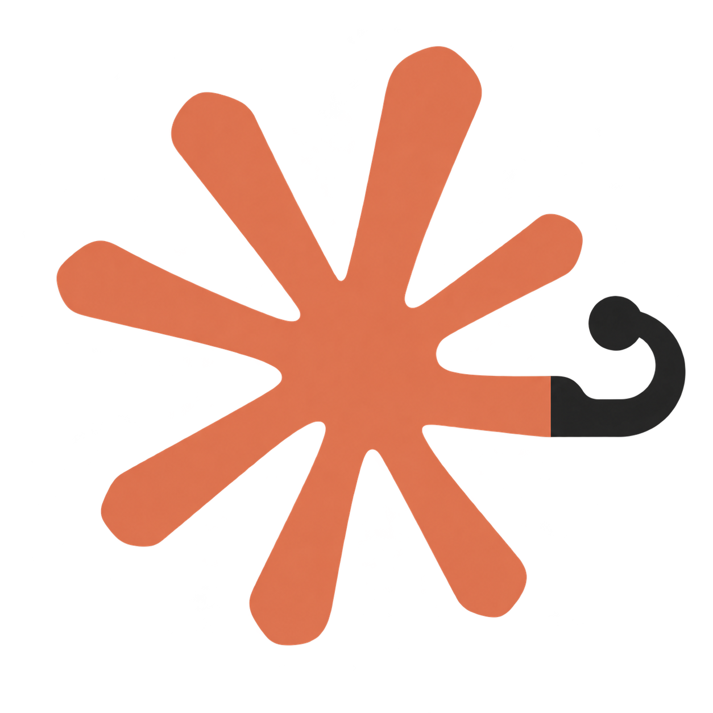

<div align="center">



# control-claude-code

**Native-grade remote control for Claude Code, for users on third-party relay API keys**

[](https://github.com/DotRacel/control-claude-code/actions/workflows/ci.yml)
[](https://github.com/DotRacel/control-claude-code/actions/workflows/injection-compat.yml)
[](https://www.npmjs.com/package/control-claude-code)
[](https://nodejs.org)
[](LICENSE)

[简体中文](README.md) · **English**

</div>

---

Desktop and phone are both supported, and the backend can be self-hosted to keep your data private.

Currently tested on Linux and macOS.

## Install

Requires Node.js 22.23.4+ (22.x), 24.22.1+ (24.x), or 26.12.1+ (26.x). These versions include the
[October 2026 security fixes](https://nodejs.org/en/blog/vulnerability/october-2026-security-releases),
including the Brotli decoder remote code execution fix. Upgrade the host's Node.js when updating
the CLI too. For source development, run `nvm install && nvm use` to use the version in `.nvmrc`.

```bash
npm i -g control-claude-code
```

Because of how it is implemented, this project is sensitive to Claude Code updates — so installing
a stable version of Claude Code is recommended.

## Usage

```bash
control-claude       # replaces the `claude` command and starts a controlled Claude Code
```

When you want to hand off to remote control, just use `/rc` or `/remote-control`, exactly as
official subscription users do.

By default the project submits remote control to the `https://ccc.racel.dev` backend. On first
launch you will be asked to configure a backend, where you can point it at your own self-hosted
one. The backend I currently run is not production-ready yet, so it is not open to the public
for now.

Configuration is stored at `~/.config/control-claude-code/config.json`. If you need to log in
again, use the `--login` flag.

Any other arguments are passed through to Claude Code untouched, for example:

```bash
control-claude --resume
control-claude -c --model opus "fix this bug"
control-claude -- --help          # everything after -- is claude's
control-claude --headless         # phone-only, no TUI
```

## Self-hosting the backend

Download this project's Docker Compose file, or simply clone the repository, then start it with:

```bash
INVITE_CODE=<invite code> docker compose up -d
```

The server listens on `:8787` by default — change it as needed. If the `INVITE_CODE` environment
variable is not set, registration is disabled.

To update an existing deployment, pull the new image and recreate the app container, keeping the
database volume:

```bash
docker compose pull app
docker compose up -d --no-deps app
docker compose exec app node --version  # v24.22.1
```

## Docs & development

See [AGENTS.md](AGENTS.md) for the reference docs and the local development loop.

## License

[PolyForm Noncommercial 1.0.0](LICENSE). Use it, change it, share it — for personal use, study
and research. Commercial use is not granted, and that includes use inside a company. `claude`
itself is Anthropic's, and this is a client for their product.
